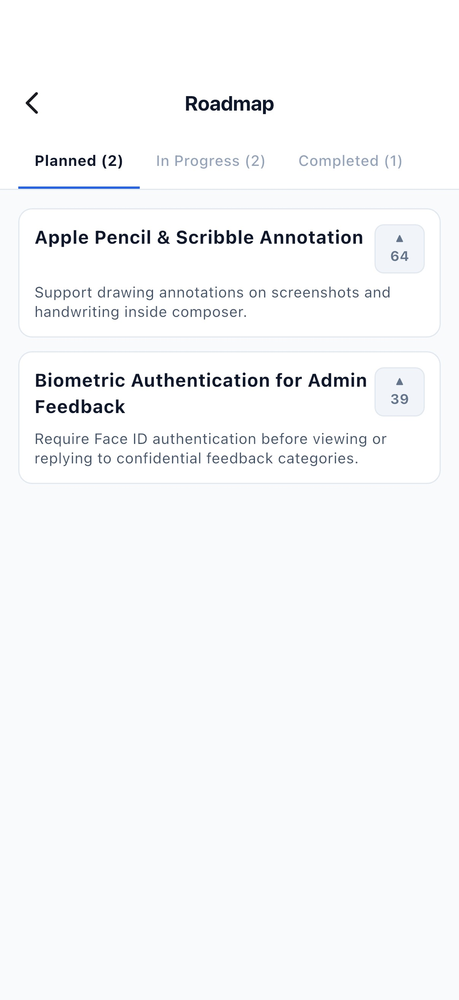
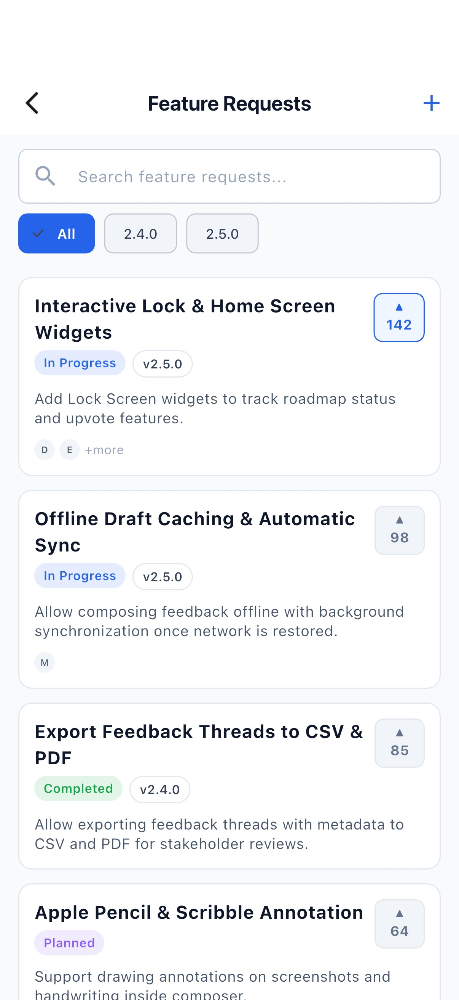
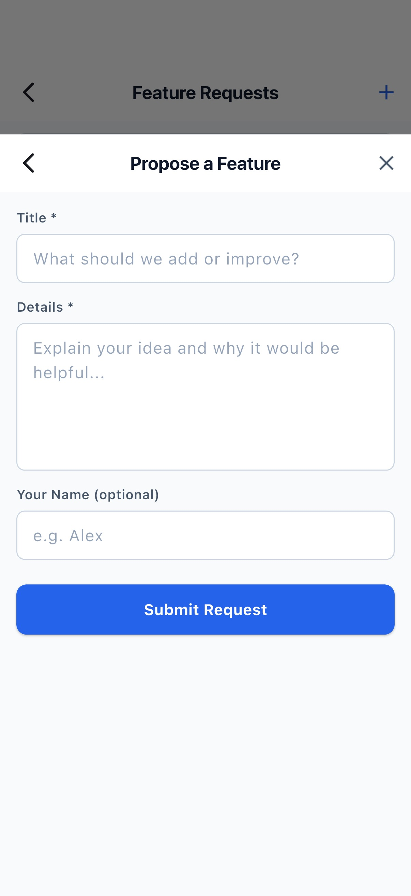
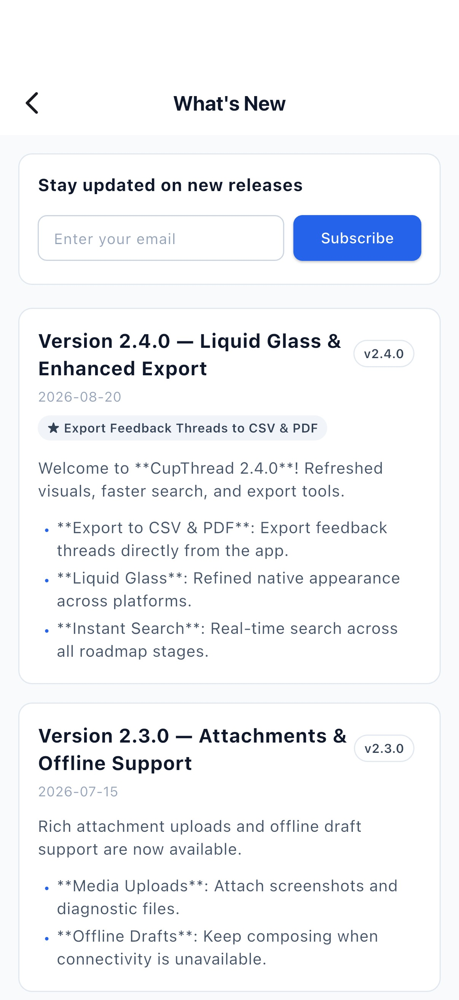
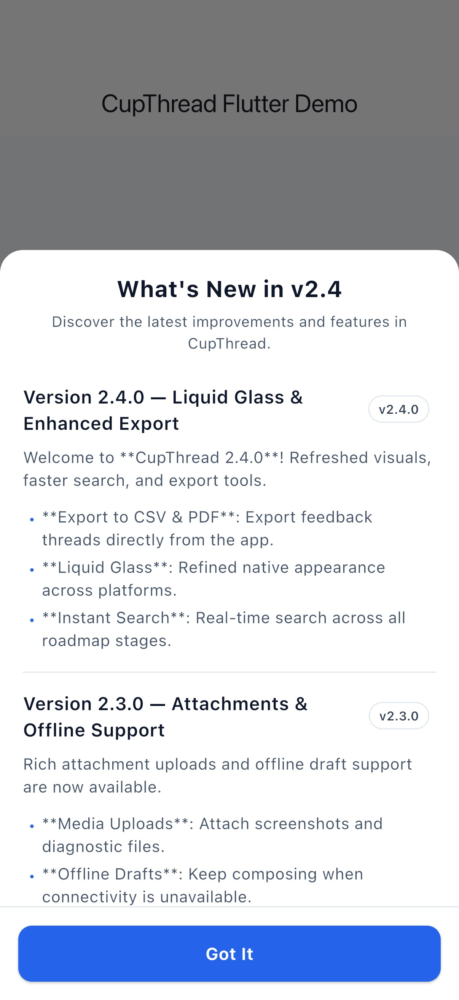
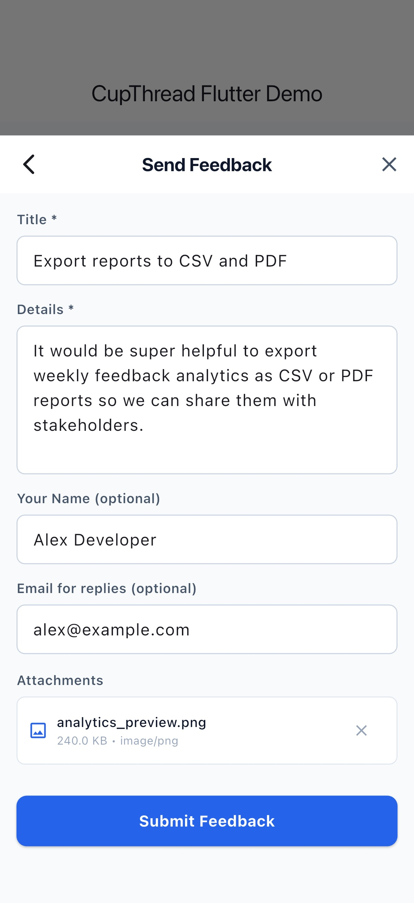

# CupThread Flutter SDK

Official Dart + Flutter SDK for cross-platform apps (iOS, Android, macOS, Windows, Linux, Web).

Part of the [CupThread.com](https://cupthread.com) platform.

## 🤖 Recommended: Install via AI Agent (Agentic Coding)

Instead of manually editing `pubspec.yaml` and wiring widgets by hand, install the official **CupThread Flutter AI Skill** into your workspace with [`npx skills`](https://github.com/skills-directory/skills) and let your AI assistant (Claude Code, Cursor, Copilot, Windsurf, Codex, Antigravity) integrate and customize it for you:

```sh
npx skills add CupThread/CupThreadAgenticCoding --skill cupthread-flutter-sdk
```

Once installed, simply copy and paste this prompt to your AI coding agent:

```text
Integrate the CupThread SDK (feedback, roadmap, and changelog screens) into this Flutter app. Scaffold a dedicated configuration helper with a placeholder for the App Key, and at the end, remind me with step-by-step instructions on how to set my App Key safely (e.g. via --dart-define or .env).
```

---

## CupThread Ecosystem
- 🌐 [CupThread.com](https://cupthread.com) — Feedback SaaS platform, developer console, and API.
- 🍏 [CupThread/CupThreadSwiftSDK](https://github.com/CupThread/CupThreadSwiftSDK) — Apple platform SDK (SwiftUI / SPM / XCFramework).
- 🤖 [CupThread/CupThreadAndroidSDK](https://github.com/CupThread/CupThreadAndroidSDK) — Android SDK (Jetpack Compose / Maven).
- ⚛️ [CupThread/CupThreadReactNativeSDK](https://github.com/CupThread/CupThreadReactNativeSDK) — React Native & Expo SDK (TypeScript).
- 💙 [CupThread/CupThreadFlutterSDK](https://github.com/CupThread/CupThreadFlutterSDK) — Flutter SDK (Dart).
- 🧠 [CupThread/CupThreadAgenticCoding](https://github.com/CupThread/CupThreadAgenticCoding) — AI-friendly CLI & Skills for pair programming.

---

## Visual Showcase

The screenshots below are captured automatically from the Flutter example app using deterministic mock API data, so they stay in sync with the shipped widgets.

| **Roadmap Board** | **Feature Requests** | **Submit Request** |
| :---: | :---: | :---: |
|  |  |  |
| Kanban columns, stage chips & vote counts | Optimistic voting, search & version filter | User feature request compose sheet |

| **What's New / Changelog** | **Changelog Modal Overlay** | **Feedback Composer** |
| :---: | :---: | :---: |
|  |  |  |
| Markdown release notes & email subscription | In-app announcement sheet with custom copy | Structured feedback with attachment preview |

---

## Manual Installation

### Option A: Via Git Dependency (Direct GitHub release)

In your `pubspec.yaml`:

```yaml
dependencies:
  cupthread_feedback:
    git:
      url: https://github.com/CupThread/CupThreadFlutterSDK.git
      ref: v0.1.0
```

### Option B: pub.dev

**Not available yet.** `cupthread_feedback` is currently distributed only through the git dependency above — the package has not been published to pub.dev, so `flutter pub add cupthread_feedback` will not resolve. This section will document the registry install once publishing is enabled.

---

## Quick Start

```dart
import 'package:flutter/material.dart';
import 'package:cupthread_feedback/cupthread_feedback.dart';
import 'package:shared_preferences/shared_preferences.dart';

Future<void> main() async {
  WidgetsFlutterBinding.ensureInitialized();

  // Optional but recommended: configure one durable key-value store once,
  // before mounting CupThreadTheme. The anonymous identity AND changelog
  // "seen" state persist through this adapter; without it both are
  // in-memory and reset on every app launch. The SDK is pure Dart, so
  // bring your own adapter (e.g. backed by shared_preferences):
  UserTokenStore.configure(
    SharedPreferencesTokenStorage(await SharedPreferences.getInstance()),
  );

  final client = FeedbackClient(
    FeedbackClientConfig(
      baseUrl: 'https://api.cupthread.com',
      appKey: 'app_xxx', // from your CupThread Developer Console
      sdkSigningSecret: 'sec_xxx', // Optional: required for reporting payment attributes (isPaying, mrr, plan)
      // Optional: Turnstile token provider for production intake (or set per draft)
      turnstileTokenProvider: () async {
        // Obtain token via flutter_turnstile, webview, or native bridge
        return await myTurnstileService.getToken();
      },
      // Optional: network timeouts (defaults: 15s request, 60s upload)
      requestTimeout: const Duration(seconds: 15),
      uploadTimeout: const Duration(seconds: 60),
    ),
  );

  runApp(
    CupThreadTheme(
      client: client,
      // Optional: set custom locale or string overrides (defaults to device locale or English)
      // locale: const Locale('zh', 'CN'),
      // strings: CupThreadStrings.zhHans,
      child: const MaterialApp(
        home: RoadmapBoardScreen(),
      ),
    ),
  );
}

/// Minimal shared_preferences-backed adapter (see the example app).
class SharedPreferencesTokenStorage implements TokenStorageAdapter {
  SharedPreferencesTokenStorage(this._prefs);

  final SharedPreferences _prefs;

  @override
  Future<String?> getItem(String key) async => _prefs.getString(key);

  @override
  Future<void> setItem(String key, String value) async {
    await _prefs.setString(key, value);
  }
}
```

---

## Persisting the Anonymous Identity (Recommended)

The SDK is pure Dart and ships no storage plugin, so by default the anonymous user token lives in memory only — every app launch would mint a fresh identity, losing vote ownership, own-request highlighting, and changelog seen-state. Wire any key-value store via `UserTokenStore.configure(...)` before mounting `CupThreadTheme`:

```dart
import 'package:shared_preferences/shared_preferences.dart';
import 'package:cupthread_feedback/cupthread_feedback.dart';

Future<void> main() async {
  WidgetsFlutterBinding.ensureInitialized();

  UserTokenStore.configure(
    SharedPreferencesTokenStorage(await SharedPreferences.getInstance()),
  );

  runApp(const MyApp());
}

/// Any key-value store works — implement TokenStorageAdapter.
class SharedPreferencesTokenStorage implements TokenStorageAdapter {
  SharedPreferencesTokenStorage(this._prefs);
  final SharedPreferences _prefs;

  @override
  Future<String?> getItem(String key) async => _prefs.getString(key);

  @override
  Future<void> setItem(String key, String value) async {
    await _prefs.setString(key, value);
  }
}
```

`CupThreadTheme` defers its first child build until the persisted token has been restored from storage (typically a single frame), so widgets never observe a throwaway identity while the durable one is still loading. The synchronous `UserTokenStore.token` accessor returns a stable ephemeral placeholder instead of minting-and-caching a UUID, so it can never overwrite a token that exists in storage.

---

## Ready-Made Flutter Widgets & Screens

Wrap your widget hierarchy in `CupThreadTheme(client: client)` to automatically inherit developer console appearance settings, color palette, localized strings, and anonymous user token.

- **`RoadmapBoardScreen()`**: Kanban roadmap board grouped by public columns with vote counts and stage badges.
- **`FeatureRequestsScreen()`**: Searchable feature requests list with optimistic upvoting, version filter chips, and creation sheet.
- **`FeatureRequestComposeSheet.show(context)`**: Dedicated sheet for proposing a new feature request (`POST /api/v1/feature-requests`).
- **`WhatsNewScreen()`**: Interactive release notes / changelog with Markdown formatting and email subscription.
- **`ChangelogOverlay.show(context, onlyIfUnseen: true)`**: In-app modal announcement sheet for the latest release notes. Seen versions persist through the adapter configured on `UserTokenStore` (in-memory by default — see Quick Start for the one-line durable setup).
- **`FeedbackComposer()` / `FeedbackComposer.showModal(context, onPickAttachment: ...)`**: Structured feedback form with attachment uploads and host picker support.
- **`UserProfileView(userId: ...)`**: Public user/developer profile screen.

### Example: Presenting Latest Changelog on Launch (Only If Unseen)

```dart
@override
void initState() {
  super.initState();
  WidgetsBinding.instance.addPostFrameCallback((_) {
    // Only shows if the user hasn't seen this release yet, and automatically marks it seen
    ChangelogOverlay.show(context, onlyIfUnseen: true);
  });
}
```

### Example: Providing Attachment Picker to FeedbackComposer

```dart
FeedbackComposer.showModal(
  context,
  onPickAttachment: () async {
    // Pick image via image_picker or file_picker, then upload:
    // final bytes = await file.readAsBytes();
    // return await client.uploadAttachment(
    //   bytes: bytes,
    //   filename: file.name,
    //   mimeType: 'image/png',
    //   userToken: CupThreadTheme.userTokenOf(context),
    // );
    return null;
  },
);
```

---

## Anonymous Access Policies

The Developer Console exposes four per-app anonymous policies that the SDK
enforces client-side (the server enforces them too, but the SDK fails fast
with a localized sign-in state instead of a guaranteed-to-fail network call):

| Policy | Enforced by | Anonymous behavior when disabled |
| ------ | ----------- | -------------------------------- |
| `allowAnonymousRoadmap` | `RoadmapBoardScreen` | Sign-in-required state; no board/columns fetch |
| `allowAnonymousVote` | `FeatureRequestsScreen`, `RoadmapBoardScreen` | Vote tap shows a snackbar; no vote call |
| `allowAnonymousFeedback` | `FeedbackComposer` | Submit shows a snackbar; no feedback call |
| `allowAnonymousChangelog` | `WhatsNewScreen`, `ChangelogOverlay.show`, `FeedbackClient.prepareChangelogOverlay` | Sign-in-required state / overlay never presents; no changelog fetch |

`allowPublic` on `PublicAppConfig` is informational only: the server enforces
it (a private app's config endpoint returns 404), so the SDK does not consume
it.

---

## API Client Surface

| Method | Endpoint | Description |
| ------ | -------- | ----------- |
| `submit(draft, userToken?)` | `POST /api/v1/feedback` | Submit feedback draft with metadata and attachments |
| `uploadAttachment(...)` | `POST /api/v1/uploads/{images,r2}` | Upload screenshot or log attachment |
| `fetchAppConfig()` | `GET /api/v1/public/config/{appKey}` | Fetch app branding, appearance, and public settings |
| `fetchColumns()` | `GET /api/v1/public/columns/{appKey}` | Fetch Kanban board columns for roadmap |
| `fetchVersions()` | `GET /api/v1/public/versions/{appKey}` | Fetch release versions |
| `fetchFeatureRequests(...)` | `GET /api/v1/feature-requests` | List and search public feature requests |
| `submitFeatureRequest(draft, userToken)` | `POST /api/v1/feature-requests` | Propose a new feature request |
| `castVote(featureRequestId, userToken)` | `POST /api/v1/feature-requests/{id}/vote` | Cast an upvote (insert-only, idempotent) |
| `removeVote(featureRequestId, userToken)` | `DELETE /api/v1/feature-requests/{id}/vote` | Remove an upvote (idempotent) |
| `fetchComments(featureRequestId)` | `GET /api/v1/feature-requests/{id}/comments` | Fetch discussion comments |
| `postComment(featureRequestId, draft, userToken)` | `POST /api/v1/feature-requests/{id}/comments` | Post a comment or reply |
| `fetchChangelog()` | `GET /api/v1/public/apps/{appKey}/changelog` | Fetch published release notes (follows cursor pagination) |
| `fetchChangelogPage(limit, cursor)` | `GET /api/v1/public/apps/{appKey}/changelog` | Fetch one page of release notes (`hasMore` / `nextCursor`) |
| `subscribeToChangelog(email, userToken)` | `POST /api/v1/public/apps/{appKey}/changelog/subscribe` | Subscribe email to changelog |
| `unsubscribeFromChangelog(email)` | `POST /api/v1/public/apps/{appKey}/changelog/unsubscribe` | Unsubscribe email from changelog |
| `updateUserAttributes(...)` | `PUT /api/v1/public/apps/{appKey}/user` | Report user attributes (paying, plan, MRR with HMAC signing) |
| `fetchUserProfile(userId)` | `GET /api/v1/users/{userId}/profile` | Fetch public user profile |

---

## Development & Testing

```sh
# Fetch dependencies
flutter pub get

# Run analysis
flutter analyze

# Run unit tests
flutter test

# Capture the visual showcase on an iOS Simulator
scripts/capture-screenshots.sh "iPhone 16 Pro"

# Build API documentation (the showcase is copied into the generated site)
scripts/build-docs.sh docs-site
```

### Releasing (maintainers)

```sh
# Preflight, bump pubspec.yaml, commit, tag vX.Y.Z, push, and create the GitHub Release
node scripts/release.mjs --version X.Y.Z

#   --dry-run     run every preflight check without writing, pushing, or tagging
#   --yes         skip the interactive confirmation (required in non-TTY/CI runs)
#   --skip-tests  skip `flutter test` (not recommended)
```

The script refuses a dirty worktree, fails when the tag already exists, runs `flutter pub get` / `analyze` / `test`, and asserts the pushed tag matches the `pubspec.yaml` version. Publishing to pub.dev is not part of the pipeline yet; released versions install through the git dependency above.

## License
MIT
